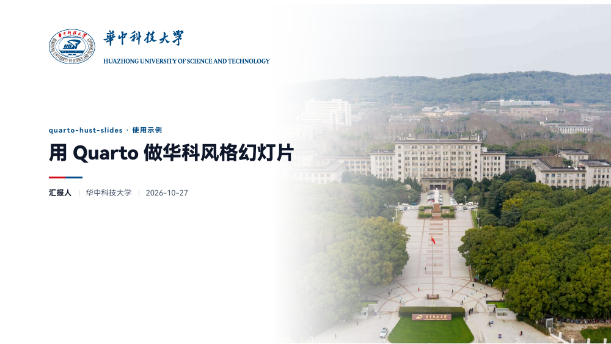
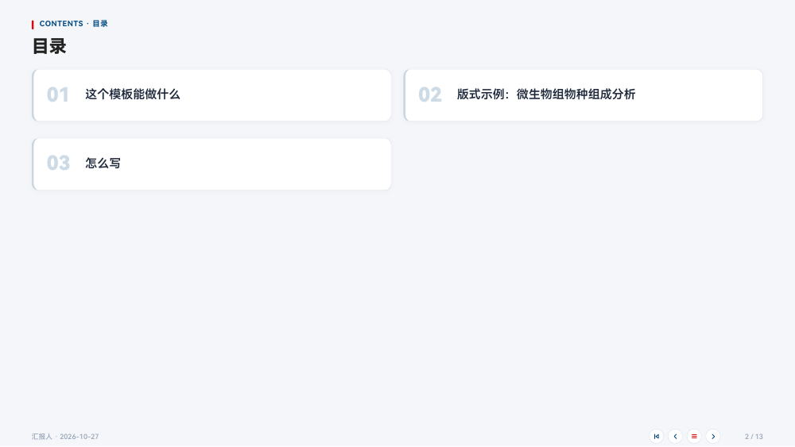
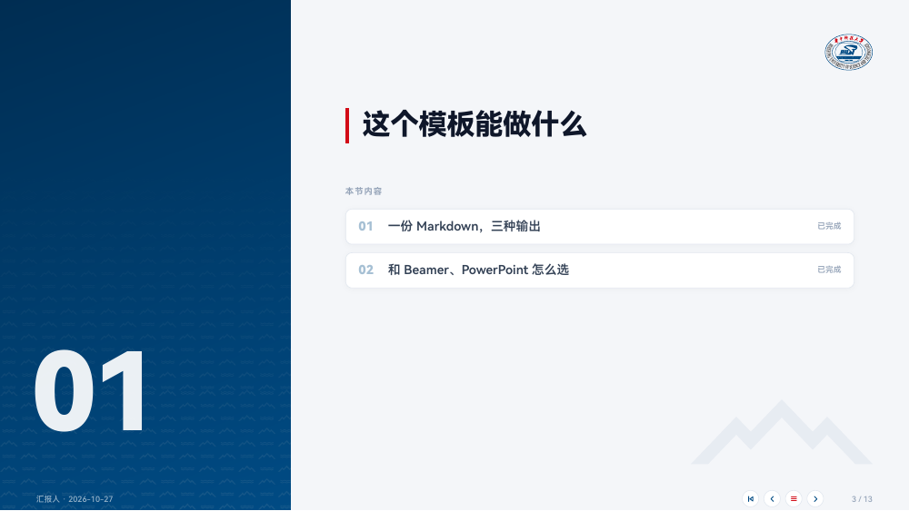
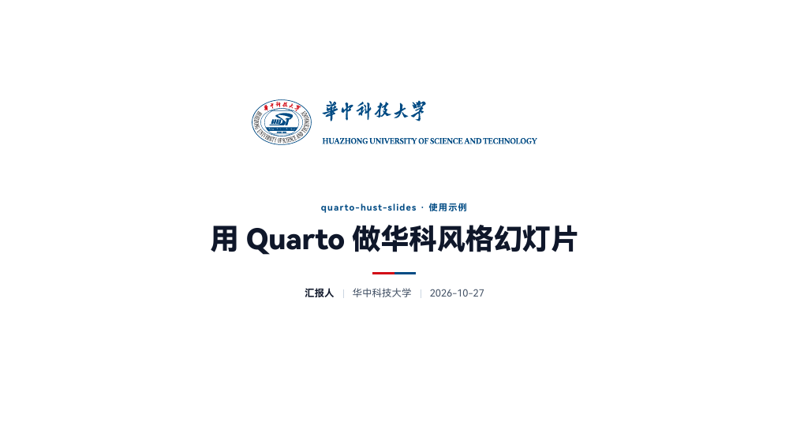

# quarto-hust-slides · 华科风格 Quarto 幻灯片模板

一份 Markdown，同时得到三种汇报文件：

- **单文件 HTML**：放映用，图片全部内嵌，直接发给别人就能打开；支持触屏翻页、讲者视图
- **PDF**：每页右下角有翻页图标，目录、分节导览都能点击跳转
- **PPTX**：会议室只认 PowerPoint 时用，排版与 PDF 一致，演讲者备注写进备注栏

配色、校徽、辅助图形取自华中科技大学视觉形象识别系统；封面和结尾可以放校园风光照片。

**最省事的用法：你只写 Markdown 或纯文本大纲，交给大模型（Claude、ChatGPT、Copilot 等）按约定转成 qmd，再一行命令渲染。**见“[写 md，让大模型转成 qmd](#写-md让大模型转成-qmd推荐)”。项目自带 agent skill（`skills/quarto-hust-slides/`），见“[对 AI / agent 友好](#对-ai--agent-友好)”。

| 封面 | 目录 | 分节页 | 结尾页 |
|---|---|---|---|
|  |  |  |  |

无图模式（`photos: false`）封面与结尾页居中、白底，体积更小：



完整示例：[默认样式 PDF](preview/template_demo.pdf) · [无图模式 PDF](preview/template_nophoto.pdf) · [分节页也放照片 PDF](preview/template_photo.pdf)

> **为什么做这个模板**：组会、开题、答辩反复做 PPT，排版花的时间比内容还多；用 Beamer 改样式又太麻烦。这个模板把华科的视觉规范、常用版式和导出流程一次做好：你只管写内容（甚至只写 md，让 AI 助手转成 qmd），剩下的交给脚本。
>
> 这是第一版，欢迎提 [Issue](https://github.com/zevellong/quarto-hust-slides/issues) 或 PR 一起改进。

> ⚠️ **适用平台**：目前**只在 Linux（Arch Linux）上完整测试过**。macOS 理论上可用（同为 bash 环境），未测试。**Windows 未测试**：`tools/` 下是 bash 脚本，建议在 WSL 中使用；不用 WSL 时，可以直接 `quarto render slides.qmd` 生成 HTML，再用浏览器打印成 PDF（见“[不用脚本也能用](#不用脚本也能用windows--没有-bash)”）。

---

## 目录

- [三步上手](#三步上手)
- [写 md，让大模型转成 qmd（推荐）](#写-md让大模型转成-qmd推荐)
- [对 AI / agent 友好](#对-ai--agent-友好)
- [幻灯片目录长什么样](#幻灯片目录长什么样)
- [怎么写：常用写法速查](#怎么写常用写法速查)
- [个性化](#个性化)
- [输出与放映](#输出与放映)
- [常见问题](#常见问题)
- [官方文档](#官方文档)
- [素材来源与版权](#素材来源与版权)
- [模板结构与维护](#模板结构与维护)

---

## 三步上手

### 0. 准备环境（只需一次）

| 软件 | 用途 | 安装参考 |
|---|---|---|
| [Quarto](https://quarto.org/docs/get-started/) ≥ 1.4 | 把 qmd 渲染成幻灯片（**必需**） | 官网安装包；或 `conda install -c conda-forge quarto` |
| Chromium / Chrome | 导出 PDF | 系统包管理器 |
| poppler（`pdftoppm`、`pdfinfo`） | 检查 PDF 页数、生成 PPTX | `pacman -S poppler` / `apt install poppler-utils` |
| ImageMagick | 处理校园照片 | `pacman -S imagemagick` / `apt install imagemagick` |
| Python + `python-pptx`、`beautifulsoup4` | 生成 PPTX（可选） | `pip install python-pptx beautifulsoup4` |

### 1. 获取模板与照片

```bash
git clone https://github.com/zevellong/quarto-hust-slides.git
TPL=$PWD/quarto-hust-slides
bash $TPL/tools/fetch_photos.sh      # 可选：下载全部 38 张校园照片（约 1 分钟）
```

仓库已内置默认搭配的 3 张照片（封面南大门鸟瞰、结尾红嘴鸥、分节可选的校大门秋），**不运行 `fetch_photos.sh` 也能直接用**；想换其他照片时再运行它，看到 `新下载 38 张` 即成功。

### 2. 新建一套幻灯片

```bash
bash $TPL/tools/new_deck.sh ~/proj_x/doc slides
```

会在 `~/proj_x/doc/` 生成 `slides.qmd`（示例内容）、`config.yml`、`fig/` 和 `_extensions/hust/`。打开 **`config.yml`，把 `author: "汇报人"` 改成你的名字**（以后同一个项目都不用再改）。

### 3. 渲染

```bash
bash $TPL/tools/render.sh ~/proj_x/doc/slides.qmd --pptx
```

终端看到 `Output created: slides.html`、`PDF 第 1 次导出：12 页`、`已生成 slides.pptx` 即完成。浏览器打开 `slides.html` 就能放映。之后改 `slides.qmd` → 再跑这一行。

> 报错时先读终端输出，Quarto 的错误信息一般足够明确；常见问题见[下文](#常见问题)。

---

## 写 md，让大模型转成 qmd（推荐）

不想记任何写法？只写内容，排版交给大模型。

**1. 你写的东西**——普通 Markdown 或纯文本大纲都行，例如：

```markdown
# 背景
## 宏基因组物种组成分析有很多工具，结果不一致
- 方法：k-mer、标记基因、比对
- 用模拟群落（ZymoBIOMICS D6300）检验准确度
- 图：fig/zymo.svg

# 结果
## Metax 在低丰度酵母上检出更稳定（进行中）
- 8 种细菌各 12%，2 种酵母各 2%
- 待补：假阳性统计
演讲时提一句：数据为基因组 DNA 口径
```

**2. 交给大模型的提示词**——在幻灯片目录里打开 AI 助手（Claude Code、Cursor、Copilot 等能读文件的最好），或者把下面这段连同你的 md 一起粘贴进聊天窗口：

```text
请把 talk.md 转换成 slides.qmd（Quarto 华科模板 quarto-hust-slides）。
严格遵守 _extensions/hust/README.md 中的“md → qmd 转换约定”：
- 头部只写 title / subtitle / data-short-title / metadata-files: [config.yml] / format: hust-revealjs，不写姓名单位；
- 头部之后第一行是 “## 目录 {.toc}”，第一个 ## 之前不要放任何 HTML 或注释；
- md 一级标题 → “# 一 部分名”（分节页），二级标题 → “## 结论式标题”（内容页）；
- 状态：完成 [✅]{.status}、进行中 [⏳]{.status}、待补 [📋]{.status}；
- 列表放进 ::: {.points}（每页 2–5 条，每条尽量 20 字内），关键数字写成 [12%]{.hl}；
- 有图用 :::: {.columns} 左图右文，图片只写 height；有一组数字用 ::: {.stats}；
- “待补”写成 ::: {.todo}，结论写成 ::: {.key}，口头补充写成 ::: {.notes}；
- 最后一页 “## 谢谢 {.end}”；不要编造 md 里没有的数字或结论。
```

没有 `_extensions/hust/README.md` 可读时（网页版聊天），把那份文件的内容一起贴进去即可。

**3. 渲染并检查**

```bash
bash $TPL/tools/render.sh slides.qmd
```

检查两点：PDF 页数是否等于幻灯片数（多出来说明某页太满，让大模型精简那一页）；数字和结论是否与原稿一致。不满意就让大模型“把第 5 页改成左图右文”“这一页要点太多拆成两页”，再渲染。

---

## 对 AI / agent 友好

这个模板的设计初衷是：**人只关注内容，排版交给工具和 AI**；同时扩展性强，换校徽、照片、颜色就能变成其他学校或公司的风格。为此整个项目对 agent 友好：

- **一切皆纯文本**：内容（qmd）、配置（`config.yml`）、样式（SCSS）都是文本，agent 能读能改，git 能追踪。
- **脚本无交互**：`new_deck.sh`、`render.sh` 一条命令完成，输出明确（`Output created`、`PDF … 页`）。
- **有可自动检查的标准**：PDF 页数 = 幻灯片数；不相等就说明某页溢出。
- **约定写成文件**：转换规则、版式写法、换皮肤步骤都有文档，不靠口口相传。

**agent skill**：`skills/quarto-hust-slides/` 打包了这些知识，供 Claude Code 等支持 skill 的 agent 使用，也可以直接当说明书读：

| 文件 | 内容 |
|---|---|
| `SKILL.md` | 何时使用；四个工作流：新建、md / 纯文本 → qmd、渲染与检查、换皮肤；选项与排错速查 |
| `references/md2qmd.md` | 完整转换规则 + 输入 / 输出对照示例 |
| `references/layouts.md` | 全部版式写法与每页容量经验（防溢出） |
| `references/rebrand.md` | 改成其他学校 / 公司：颜色变量、Logo 与名称、照片、验证清单 |

使用方法：让 agent 先读 `skills/quarto-hust-slides/SKILL.md`（例如“按 quarto-hust-slides 仓库里的 skill，把 talk.md 做成幻灯片”）。需要时也可以把这个目录复制到你所用 agent 的 skills 目录里。

---

## 幻灯片目录长什么样

```
doc/
├── slides.qmd        # 只写内容
├── config.yml        # 姓名、单位、日期、照片、结尾分享卡片
├── deck.css          # 可选：本次专用样式
├── fig/              # 你的图（以及可选的 share_enable.png）
├── _extensions/hust/ # 模板样式与素材（Quarto 规定必须叫 _extensions；不用管、不要手改）
└── slides.html / slides.pdf / slides.pptx   # 生成物
```

脚本不复制到幻灯片目录，统一从模板 `tools/` 调用；照片也不复制，渲染时从模板 `photos/web/` 读取，只内嵌用到的几张。

### 信息放哪里

| 信息 | 写在哪 | 说明 |
|---|---|---|
| 姓名、单位 | `config.yml` | 每个项目改一次 |
| 日期 | `config.yml` 默认 `date: today` | 渲染当天自动填写；**答辩、会议等固定日期**在 qmd 头部写 `date: 2026-11-05`（qmd 头部优先于 config） |
| 标题、副标题、短标题 | qmd 头部 | 每次汇报不同；短标题显示在节外页面的眉题 |
| 照片、分享卡片 | `config.yml` 的 `hust:` | 见“[个性化](#个性化)” |
| 本次专用样式 | `deck.css` | qmd 中 `format: hust-revealjs: css: deck.css` |

一个最小的 qmd 头部：

```yaml
---
title: "汇报标题：一句话说明核心结论"
subtitle: "项目名称 · 阶段进展"
metadata-files: [config.yml]
format: hust-revealjs
---
```

---

## 怎么写：常用写法速查

一级标题 `#` 是**分节页**，二级标题 `##` 是**内容页**。下面每段都可以直接复制。

**目录页**（自动生成，放在头部之后第一行）

```markdown
## 目录 {.toc}
```

**分节页 + 内容页 + 状态标签**

```markdown
# 一 背景与问题

## 标题写结论：一句话说明发现 [✅]{.status}
```

状态：`✅` 已完成（绿）、`⏳` 进行中（琥珀）、`📋` 待补（灰）。分节页会自动列出本节各页标题和状态。

**要点卡片**（每页 2–5 条，每条尽量 20 字以内）

```markdown
::: {.points}
- **加粗**为深色强调，[提升 12%]{.hl} 为华科红关键数字
- 标题写结论，要点写证据
:::
```

**左图右文**（方图、树图）

```markdown
:::: {.columns}
::: {.column width="60%"}
{height="620"}
:::
::: {.column width="40%" .points}
- 图片只写 height 或 width 之一，比例自动保持
:::
::::
```

宽图用“上图下文”：图 `height≈300–420`，下面接 `:::: {.columns .points}` 两栏。

**指标卡**

```markdown
::: {.stats}
::: {.stat}
[8]{.num} 种细菌
:::
::: {.stat .red}
[2%]{.num} 每种酵母
:::
:::
```

**提示框、参考文献、演讲者备注、结尾页**

```markdown
::: {.key}
结论框（红）；{.note} 说明框（蓝）；{.todo} 待补框（琥珀）
:::

::: {.refs}
Author A, et al. Title. *Journal* 2026;1:1–10.
:::

::: {.notes}
只在讲者视图（按 s）和 PPTX 备注栏里出现。
:::

## 谢谢 {.end}

欢迎批评指正
```

| 写法 | 效果 |
|---|---|
| 封面（自动） | 图片模式：左上彩色校徽 + 中英文校名，副标题作眉题、主标题、红蓝双色短线、“作者 ｜ 单位 ｜ 日期”，右半照片向左渐隐；无图模式：以上内容整体居中，无底纹 |
| `## 目录 {.toc}` | 两列编号白卡片，触碰时左线变红；点击跳转（PDF 中同样可点） |
| `# 一 某部分` | 左 32% 华科蓝渐变窄条 + 大号编号；右上彩色校徽；“本节内容”自动列出本节各页，可点击；节内超过 4 页自动紧凑 |
| `## 标题` | 眉题（`02 · 当前节名`）+ 大号主标题 + 细分隔线 |
| 表格 | 三线表白色卡片，表头浅蓝底 |
| 图片 | 自动加白色画框、圆角、阴影；`{.no-frame}` 去画框 |
| 页脚 | 左：作者 · 日期；右：页码 |

> **两条规矩**：① 第一个 `##` 之前不要放任何 HTML 块或注释，否则会多出一张空白页；② 图片只写 `height` 或 `width` 之一，否则会变形。

---

## 个性化

### 照片模式（默认开启）

默认：封面 011 南大门鸟瞰、分节页华科蓝窄条（更庄重）、结尾页 013 喻家湖上红嘴鸥。在 `config.yml` 中修改：

```yaml
hust:
  photos: true             # false = 无图模式（封面与结尾页居中、白底）
  cover-photo: 11          # 编号见 photos/索引.jpg
  section-photo: none      # 分节页也想放照片：竖幅 22 校大门秋最合适
  end-photo: 13
  # photo-order: cycle     # 多张时按顺序轮换（默认 random：打乱后轮换，尽量不重复）
  # photo-seed: 7          # 固定随机结果（不写则每次渲染不同）
```

每项可写：编号（`11`）、`none`、`random`（全部照片中随机）、列表 `[22, 25, 29, 36]`（其中随机）。单个分节覆盖：`# 标题 {photo="36"}`。作品类照片会自动标注“摄影：作者”。仓库内置 011、013、022 三张；用其他编号或 `random` 前先运行 `tools/fetch_photos.sh`。

### 结尾页分享卡片

结尾页右上角可以放“二维码 + 标题 + 网址”，分享模板仓库、PPT 网盘链接、项目主页等：

```yaml
hust:
  end-link: https://pan.baidu.com/s/xxxx     # 网址（HTML / PDF 中可点击）
  end-link-label: PPT 下载（提取码 abcd）     # 卡片标题，默认“扫码访问”
```

二维码图片自己生成（Chrome：地址栏右侧“分享” → 创建二维码 → 下载），命名为 **`share_enable.png`** 放在幻灯片目录或 `fig/`：**存在就显示，删掉就不显示**。

- 校徽在结尾页右上角（与分节页一致）。图片模式：分享卡片在校徽下方；无图模式：二维码、标题、网址居中排在“欢迎批评指正”下方。
- 模板 `fig/` 自带一张指向本仓库的 `share_enable.png`，`new_deck.sh` 会复制到幻灯片的 `fig/`，`config.yml` 默认 `end-link` 也是本仓库（即“使用此模板”）。不需要时删掉 `fig/share_enable.png`、注释掉 `end-link` 即可。

### 颜色、字体、版式

改模板的 `_extensions/hust/hust.scss`，然后 `bash tools/update_ext.sh <幻灯片目录>` 同步。只改这一次汇报，写在幻灯片目录的 `deck.css` 里。

| 用途 | 颜色 | `hust.scss` 变量 |
|---|---|---|
| 华科蓝（VI 标准色） | `#004B84` | `$hust-blue` |
| 深蓝（渐变起点） | `#002D52` | `$hust-blue-dark` |
| 浅蓝底（表头、说明框） | `#EBF3FA` | `$hust-blue-soft` |
| 华科红（VI 标准色） | `#D20B17` | `$hust-red` |
| 画布 / 卡片 | `#F4F6F9` / `#FFFFFF` | `$canvas` / `$card` |
| 主文字 / 次要 / 辅助 | `#0F172A` / `#475569` / `#94A3B8` | `$ink` / `$ink-2` / `$ink-3` |
| 细线 | `#E2E8F0` | `$line` |

设计原则：浅灰画布 + 白色圆角卡片；华科蓝只作结构色，华科红只作点缀；内容页不放校徽。字体优先鸿蒙黑体（HarmonyOS Sans SC），其次苹方 / 思源黑体 / 微软雅黑。自己画图建议同样以蓝色系为主、红色只标重点；绿 / 琥珀 / 灰留给状态标签。

画布为 1600 × 900（16:9），翻页无动画（`transition: none`）。需要时可在 qmd 头部覆盖：

```yaml
format:
  hust-revealjs:
    transition: fade        # none / fade / slide / convex / concave / zoom
    css: deck.css
```

### 添加自己的照片

1. **选图**：色调与华科蓝协调（蓝天、湖水、绿树、秋季暖黄）；避免过饱和、强滤镜、大面积纯黑的夜景；长边 ≥ 1600 px。按位置挑构图：**封面**横幅、主体居中或偏右（左侧会渐隐成白色）；**分节窄条**（约 512 × 900）竖幅或主体居中；**结尾页**横幅，左下角留出较暗或干净的区域放白字。
2. **命名**：`photos/NNN_名称.jpg`，编号接着现有最大号（当前 038）。
3. **登记**：在 `photos/来源.tsv` 加一行（编号、文件名、说明、作者、原图地址）；填了作者会自动署名。
4. **压缩**：`bash tools/prepare_photos.sh`。
5. **使用**：`config.yml` 写编号，如 `end-photo: 39`。

### 添加 SVG 图标 / 新素材

- **只在某一页用**：放进 `fig/`，`{height="120" .no-frame}`。
- **作为模板素材复用**：
  1. 转成精简的纯矢量 SVG：`inkscape in.pdf --export-plain-svg --export-area-drawing -o out.svg && svgo out.svg`；位图纹理用少色 PNG（`magick in.png -colors 16 out.png`）。
  2. 放进 `_extensions/hust/assets/`，命名 `hust-<用途>.svg`。
  3. 封面模板中直接引用 `_extensions/hust/assets/hust-xxx.svg`；由脚本动态插入的素材，还要在 `title-slide.html` 的隐藏列表 `.hust-assets` 中登记 ``，脚本里用 `asset('xxx', 'hust-xxx.svg')` 取用（这样单文件 HTML 也能内嵌显示）。
  4. `bash tools/update_ext.sh <幻灯片目录>` 同步。

---

## 输出与放映

| 格式 | 怎么得到 | 特点 |
|---|---|---|
| HTML | `render.sh` 或 `quarto render` | 单个自包含文件（默认 `embed-resources: true`），直接发送；触屏按钮、讲者视图。`render.sh` 会自动瘦身：示例无图模式约 0.75 MB、默认搭配约 1.4 MB |
| PDF | `render.sh`（自动导出、页数不对自动重试） | 每页右下角翻页图标；目录、“本节内容”卡片可点击；每张幻灯片限定一页 |
| PPTX | `render.sh --pptx` | 每页为整页高清图片（宽 2560 px），排版不跑版；**文字不可编辑**、跳转链接不保留；`::: {.notes}` 写入备注栏 |

**放映快捷键**（HTML）：`→` / `←` 或空格翻页；`s` 讲者视图（当前页、下一页、计时、备注，会在新窗口打开，把主窗口拖到投影屏）；`f` 全屏；`o` 或 `Esc` 总览（所有页缩略图）。触屏时用右下角四个半透明按钮：首页、上一页、目录（红）、下一页。

### PPTX 是怎么生成的

`render.sh --pptx` 调用 `tools/make_pptx.py`，分三步：

1. **PDF → 图片**：用 poppler 的 `pdftoppm` 把导出的 PDF 每页渲染成宽 2560 px 的高清图片（默认 JPEG 质量 92，`--png` 为无损）。
2. **提取演讲者备注**：用 `beautifulsoup4` 解析生成的 HTML，按页序找到每页的 `::: {.notes}`（`<aside class="notes">`）。
3. **拼成 PPTX**：用 [`python-pptx`](https://python-pptx.readthedocs.io/) 新建 16:9 空白演示文稿，每页铺一张整页图片，把备注写进该页备注栏。

所以 PPTX 的样子和 PDF 完全一致、换哪台电脑都不会跑版，演示者视图能看到备注；代价是页面上的文字不能在 PowerPoint 里改，PDF 里的跳转链接也不保留。也可以单独运行：`python tools/make_pptx.py slides.html [--png] [--width 3200]`（需先有同名 PDF）。

> 想要可编辑的 PPTX？Quarto 原生 `quarto render slides.qmd --to pptx` 可以，但卡片、指标卡、分节导览会退化成普通文字，需要手工重排，不推荐。

### 不用脚本也能用（Windows / 没有 bash）

```bash
quarto render slides.qmd       # 生成 slides.html
```

然后用 Chrome 打开 `slides.html?print-pdf`（地址后面加上 `?print-pdf`），`Ctrl+P` → 目标选“另存为 PDF”、边距“无”、勾选“背景图形”，即可得到 PDF。默认搭配的照片已内置；没有 `new_deck.sh` 时，可以直接在模板目录里改写并渲染 `template.qmd`（照片、示例图都能找到），或在 `config.yml` 的 `hust:` 下写 `photo-dir: 模板路径/photos/web`。

---

## 常见问题

| 现象 | 原因与解决 |
|---|---|
| 多出一张空白页 | 第一个 `##` 之前有 HTML 块或注释；删掉或移到后面 |
| PDF 只有 1 页 | 浏览器还没排好版就打印了；`render.sh` 会自动重试，手动导出时重来一次 |
| PDF 页数比幻灯片多 | 某页内容溢出被拆成两页；删减文字或缩小图片 |
| 图片变形 | 同时写了 `height` 和 `width`；只保留一个 |
| 封面 / 结尾没有照片 | 用了内置 3 张以外的编号却没运行 `fetch_photos.sh`；或模板移动了位置——运行 `bash tools/update_ext.sh <幻灯片目录>` 重写照片路径 |
| 结尾没有二维码 | 幻灯片目录或 `fig/` 中没有 `share_enable.png`（文件名要完全一致） |
| 日期不对 | `config.yml` 默认渲染当天；固定日期写在 qmd 头部 `date:` |
| 字体和截图不一样 | 本机没装鸿蒙黑体时会依次换用苹方 / 思源黑体 / 微软雅黑，属正常 |
| `quarto: command not found` | Quarto 不在 PATH；装在 conda 环境时设 `QUARTO_ENV=环境名` |
| 找不到 Chromium | 设 `CHROME=/path/to/chrome` |
| HTML 太大 | 用 `render.sh` 渲染：Quarto 默认会内嵌本模板用不到的 Source Sans Pro 字体（约 3 MB），`render.sh` 渲染后自动删掉；直接 `quarto render` 的文件会大约 3 MB。还想更小：`photos: false`（无图模式），线条图存 SVG、照片先压缩 |

---

## 官方文档

开始改样式之前，建议先读一遍 Quarto 的 revealjs 文档：

- [Revealjs 基础](https://quarto.org/docs/presentations/revealjs/)
- [放映（讲者视图、打印 PDF）](https://quarto.org/docs/presentations/revealjs/presenting.html)
- [进阶（背景、过渡、多列）](https://quarto.org/docs/presentations/revealjs/advanced.html)
- [主题与 SCSS 变量](https://quarto.org/docs/presentations/revealjs/themes.html)
- [自定义格式扩展](https://quarto.org/docs/extensions/formats.html)

---

## 素材来源与版权

- **视觉标识（校徽、校名、辅助图形）**：华中科技大学视觉形象识别系统 <https://vi.hust.edu.cn/> → 资源下载（A-1 校徽、A-2 校名、B-1 辅助图形）。官方 PDF 经 inkscape 转为纯矢量 SVG、svgo 压缩，放在 `_extensions/hust/assets/`（约 260 KB）。
- **校园照片**：华中科技大学官网“校园风光” <https://www.hust.edu.cn/zjhkd/xyfg/qb.htm>。文件名为网页上的图片说明，`photos/来源.tsv` 记录编号、说明、作者与原图地址。仓库只内置默认搭配的 3 张压缩版（011 南大门鸟瞰、013 喻家湖上红嘴鸥〔作者：秦敬〕、022 校大门秋），其余由 `tools/fetch_photos.sh` 从原地址下载。

| 素材文件 | 来源 | 用在 |
|---|---|---|
| `hust-emblem-color.svg` | A-1 `11.标准彩色校徽文件.pdf` | 封面、分节页右上、无图结尾页 |
| `hust-emblem-white.svg` | A-1 `14.校徽反白稿.pdf` | 图片模式结尾页 |
| `hust-name-cn-{blue,white}.svg` | A-2 `12 / 15.中文校名横蓝 / 白.pdf` | 封面 |
| `hust-name-en-{blue,white}.svg` | A-2 `20 / 23.英文校名横蓝 / 白.pdf` | 封面 |
| `hust-pattern.png` | B-1 `12.辅助底纹（山水）`（16 色 PNG，50 KB） | 分节窄条、无图结尾页 |
| `hust-mountain.svg`、`hust-water.svg` | B-1 `9.辅助图形（山）`、`10.辅助图形（水）` | 分节页右下淡色山形 |

**版权**：代码为 MIT 许可。校徽等 VI 素材与校园照片版权归华中科技大学 / 原作者所有，仅限校内学术交流使用，须遵守学校视觉形象识别规范（不变形、不改色、留足安全空间）；作品类照片须署名（模板自动标注）。详见 [LICENSE](LICENSE)。

---

## 模板结构与维护

```
quarto-hust-slides/
├── README.md / LICENSE / .gitignore
├── template.qmd           # 示例幻灯片（new_deck.sh 复制为 slides.qmd）
├── config.yml             # 配置示例（new_deck.sh 复制）
├── fig/                   # 示例图（SVG）与结尾分享二维码 share_enable.png（new_deck.sh 复制到幻灯片 fig/）
├── _extensions/hust/      # 扩展：hust.scss（配色 / 版式）、title-slide.html（封面）、hust.html（眉题 / 目录 / 分节导览 /
│                          #       页脚 / 按钮 / PDF 链接）、hust-photos.lua（照片与分享卡片）、assets/、README.md（md→qmd 约定）
├── photos/                # 来源.tsv、索引.jpg、web/ 内置 3 张压缩版；其余原图与压缩版由 fetch_photos.sh 生成
├── skills/quarto-hust-slides/   # agent skill：SKILL.md + references/（转换约定、版式速查、换皮肤）
├── tools/
│   ├── new_deck.sh        # 新建幻灯片目录
│   ├── render.sh          # HTML → PDF（自动重试）→ 可选 --pptx
│   ├── make_pptx.py       # PDF → PPTX（整页图片 + 备注）
│   ├── update_ext.sh      # 模板改动同步到已有幻灯片（只替换 _extensions/hust）
│   ├── fetch_photos.sh    # 下载照片原图并生成 web/
│   ├── prepare_photos.sh  # 新增照片后生成 web/ 压缩版
│   └── make_share.sh      # 生成可公开的干净副本 / zip
└── preview/               # 示例截图与 PDF
```

- 改样式：`hust.scss`；改眉题、目录、导览、页脚、按钮：`hust.html`；改封面：`title-slide.html`；改照片逻辑：`hust-photos.lua`。
- 改完同步到已有幻灯片：`bash tools/update_ext.sh <幻灯片目录>`（只替换 `_extensions/hust`，不动 qmd、config.yml、图）。
- 发给不用 git 的同学：`bash tools/make_share.sh` 生成 zip（含内置 3 张照片，不含其余原图；对方需要更多照片时运行 `fetch_photos.sh`）。
- `render.sh` 优先用 PATH 中的 `quarto`、`python3`、Chromium / Chrome；环境变量 `QUARTO_ENV`（quarto 装在 conda 环境时）、`CHROME`、`PPTX_PYTHON` 可指定。
