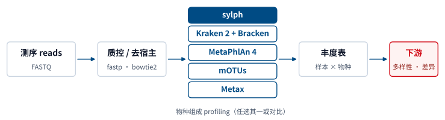
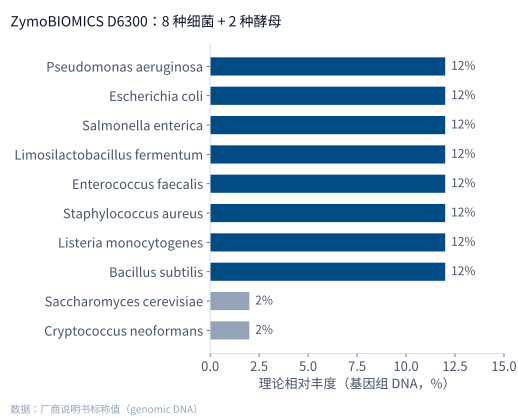

## 目录 {.toc}

# 一 这个模板能做什么

## 一份 Markdown，三种输出 [✅]{.status}

::: {.stats}
::: {.stat}
[1]{.num} 份 qmd 源文件
:::
::: {.stat}
[3]{.num} 种输出：HTML · PDF · PPTX
:::
::: {.stat .red}
[78%]{.num} 素材体积压缩（1.2 MB → 260 KB）
:::
:::

::: {.points}
- **HTML**：单个文件、图片内嵌，触屏翻页，按 `s` 打开讲者视图
- **PDF**：翻页图标、目录与分节导览都能点击跳转
- **PPTX**：整页图片不跑版，演讲者备注写入备注栏
:::

::: {.notes}
演讲者备注：只在讲者视图（按 s）中显示；生成 PPTX 时写入备注栏。
:::

## 和 Beamer、PowerPoint 怎么选 [✅]{.status}

| | Beamer | PowerPoint | 本模板 |
|---|---|---|---|
| 写作方式 | LaTeX | 拖拽排版 | Markdown |
| 版式复用 | 改主题较繁琐 | 母版 + 手工对齐 | 写一次 CSS，处处一致 |
| 放映 | PDF | Office | 浏览器（也可导出 PDF / PPTX） |
| 版本管理 | 可用 git | 二进制文件 | 纯文本，git 友好 |
| 现场改字 | 需重新编译 | 最方便 | 改 qmd 后重新渲染 |

::: {.note}
没有绝对的好坏：需要现场大改文字用 PowerPoint；公式极多用 Beamer；经常汇报、想统一风格并交给 AI 助手转换时，用本模板。
:::

# 二 版式示例：微生物组物种组成分析

## 上图下文：典型的 profiling 流程 [✅]{.status}

{height="330" fig-align="center"}

:::: {.columns .points}
::: {.column width="50%"}
- 宽图适合上图下文，图片只写 `height`
- 线条图建议存为 **SVG**，放大不发虚
:::
::: {.column width="50%"}
- 下方两栏各成一张卡片
- 中间五种工具任选其一，或做横向对比
:::
::::

## 表格：常用 profiling 工具 [✅]{.status}

| 工具 | 数据类型 | 核心方法 | 输出 |
|---|---|---|---|
| sylph | 宏基因组 reads | k-mer 草图，按 ANI 估计包含度 | 物种 / 菌株级丰度 |
| Kraken 2 + Bracken | 宏基因组 reads | k-mer 精确匹配 + LCA；Bracken 重估丰度 | 各分类层级丰度 |
| MetaPhlAn 4 | 宏基因组 reads | 进化枝特异标记基因（含 MAG 来源 SGB） | 物种 / SGB 级相对丰度 |
| mOTUs | 宏基因组 reads | 单拷贝通用标记基因 | 物种级（含未培养类群） |
| Metax | 宏基因组 reads | 比对 + 基因组覆盖度概率模型判断真实存在，EM 重估丰度 | 跨域（细菌 / 古菌 / 真核 / 病毒）物种级丰度 |

::: {.refs}
Shaw & Yu, *Nat Biotechnol* 2024（sylph）；Wood et al., *Genome Biol* 2019（Kraken 2）；Lu et al., *PeerJ Comput Sci* 2017（Bracken）；Blanco-Míguez et al., *Nat Biotechnol* 2023（MetaPhlAn 4）；Ruscheweyh et al., *Microbiome* 2022（mOTUs 3）；Deng et al., *Cell* 2026（Metax）。
:::

## 左图右文：用模拟群落检验准确度 [⏳]{.status}

:::: {.columns}
::: {.column width="56%"}
{height="600"}
:::
::: {.column width="44%" .points}
- 组成已知的**模拟群落**是检验 profiling 工具的“标准答案”
- 关注两类误差：**假阳性**物种与丰度偏差；跨域工具（如 Metax）还能检验酵母等真核成员
- 注意口径：标称值按[基因组 DNA]{.hl}计，换算成细胞数需考虑基因组大小与拷贝数
- 方图、树图适合左图右文
:::
::::

## 指标卡 + 待补框 [📋]{.status}

::: {.stats}
::: {.stat}
[8]{.num} 种细菌
:::
::: {.stat}
[2]{.num} 种酵母
:::
::: {.stat}
[12%]{.num} 每种细菌（基因组 DNA）
:::
::: {.stat .red}
[2%]{.num} 每种酵母（低丰度检验）
:::
:::

::: {.todo}
待补框：在这里放你的评测结果（检出物种数、假阳性、丰度偏差等）。
:::

::: {.key}
结论框：用一句话写结论，例如“某工具在低丰度酵母上的检出更稳定”。
:::

# 三 怎么写

## 三步上手 [✅]{.status}

```bash
git clone https://github.com/zevellong/quarto-hust-slides.git
bash quarto-hust-slides/tools/new_deck.sh ~/proj/doc slides   # 新建
# 改 ~/proj/doc/config.yml 的姓名 / 单位，写 slides.qmd
bash quarto-hust-slides/tools/render.sh ~/proj/doc/slides.qmd --pptx
```

::: {.points}
- `#` 是分节页，`##` 是内容页；标题后加 `[✅]{.status}` 显示状态
- 要点放进 `::: {.points}`，关键数字写 `[12%]{.hl}`
- 完整写法见仓库 README 的“常用写法速查”
:::

## 谢谢 {.end}

欢迎批评指正
